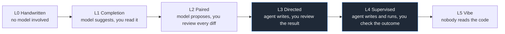

# wknd tooling

Personal dev tooling: build systems, agent harnesses, developer experience.

This is where I publish the tools I build for my own use outside work: containers, editor
setup, agent plumbing. They encode how I work, which makes them opinionated by
definition.

## What this means

- Personal, not professional. These are for my own projects outside work. My work setup
  is a different thing entirely, and the code here is not hardened for production use.
- Unmaintained by default. I fix things when I need them fixed, which may be never. There
  is no support queue and no promise to answer issues. Forking is the reliable way to
  keep something working.
- Not a standard. Nothing here is a recommendation for how you should work. Take what is
  useful to you.

## AI usage

I write the code in these repositories with AI. That is not appropriate for every
project, and I have opinions about where it is and is not. There is no single answer to
this, and so I try not to be stuck on a single opinion on it either.

- All model training rests on data collected without consent. That includes code under
  licences that forbid commercial use, and code that may only be used in exchange for
  contributing back, which no model can do. Either way the use was not permitted. That
  makes it unclear where AI-assisted output came from, and questionable to rely on.
- Using AI to produce art is not acceptable. Images, music, prose meant as art: no.
- You answer for what you ship. If the code is bad, that reflects on the person who
  shipped it, not on the model that produced it.
- What level of AI involvement is acceptable depends on the project: quality
  requirements, safety, confidentiality and commercial use all make a difference.

Where the code came from and who is responsible for it are separate questions. The
person who ships it takes the blame; that says nothing about the model's training data
or how easy the result is to license.

### How much AI is in the code

One axis, from entirely hand-written to nobody reading the output:

These repositories sit around L3 and L4. Their output matters, their source code does
not: nothing here is meant to be depended on by other people. That is a lower bar than I
would accept for software someone else has to run, which is part of why the licence is
what it is.

### Code you send to other projects

L4 and L5 are for code nobody else has to read, and that stops at the repository
boundary. Anything submitted to someone else's project stays at L3 or below, which means
a human has read the diff before it is sent.

Submitting cannot be the first time another person reads the code. If the reviewer is the
first reader, they are doing the checking the contributor skipped. That wastes their time
and disrespects it: they offered to review a contribution, not to replace the review that
should have happened first. If a model's first pass were enough for them, they would be
accepting prompts, not code contributions.

The same applies in reverse. Anything sent to me should arrive already read, and I will
not merge code that I am the first person to read.

### Commit messages

A commit message carries the name of the person who approved the commit, and nothing
else. No co-author trailer for a model, no "generated with" footer, no credit to a
harness. The human approves it, so the commit is theirs, and so is whatever it breaks
later.

The one exception is a commit that lands L4 or L5 code, where nobody read the result.
There the trailer is accurate: it tells the next reader the change was never reviewed. In
that case it is a warning, not a credit.

## Licence

Nobody can say where AI-assisted code really came from, so I do not consider it cleanly
copyrightable
and I attach no usable licence grant to it. I keep my own copyright in what I write.

In practice: you can use this for yourself, and you cannot use it commercially or inside
a business. The full text, including why, is in `LICENSE` in each repository. This is my
position, not legal advice.

## Repositories

| Repository | What it is |
| --- | --- |
| [opencode-project-template](https://github.com/wknd-tooling/opencode-project-template) | Starting point for projects where I use OpenCode: devcontainer, project config, agent instructions |
| [opencode-workflow](https://github.com/wknd-tooling/opencode-workflow) | My standard opencode workflow and the setup notes; the global config loads it directly |
